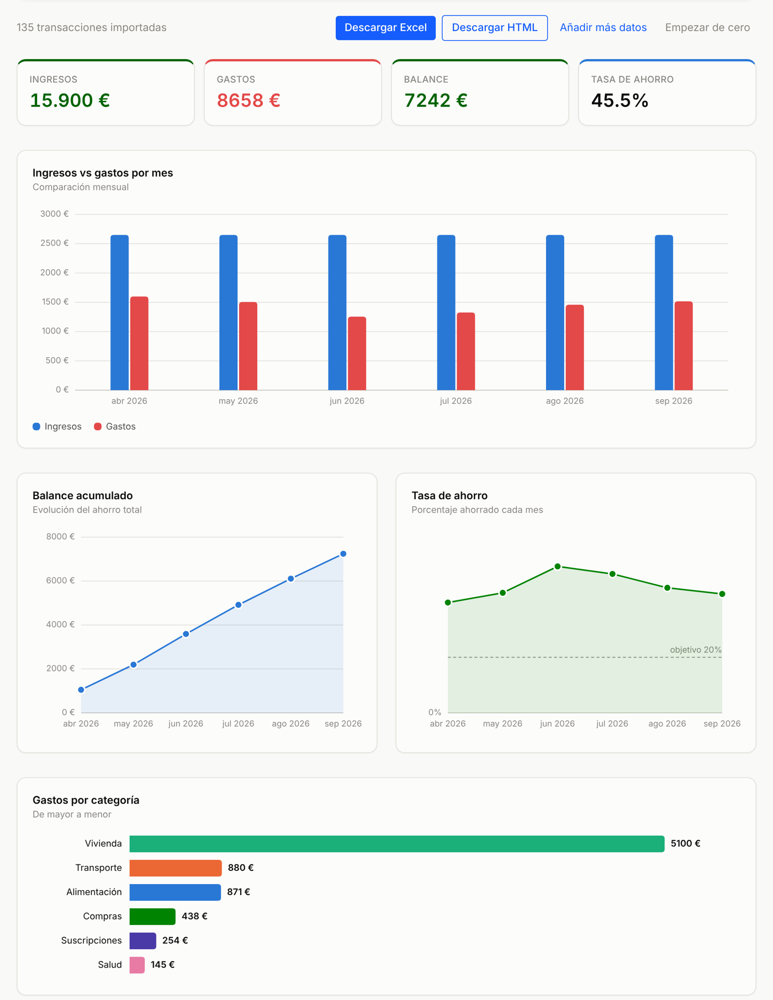

# Expenses Tracker

Drop in a bank CSV and get an interactive spending dashboard, a categorized transaction table, and a downloadable Excel or standalone HTML report.

**Live app:** https://rgst77.github.io/tracker-expenses/

<picture>
  <source media="(prefers-color-scheme: dark)" srcset="docs/dashboard-dark.png">
  
</picture>

<sub>Screenshot generated from a synthetic CSV, not real bank data.</sub>

## Privacy

Everything runs in your browser. Your files are never uploaded anywhere — there is no backend. Your transactions, categories, and rules are kept in your browser's `localStorage`, so they are still there next time you open the page on the same browser (and gone if you clear site data, so download your Excel to keep a copy).

## What it does

- **Any bank CSV.** Detects the date, description, and amount columns (you confirm them), handles day/month vs month/day dates, and lets you pick the currency (EUR, USD, GBP, NZD, AUD, MXN, ARS, CHF).
- **Dashboard.** Income vs expenses by month, cumulative balance, savings rate, and spending by category. Light and dark themes.
- **Categories you control.** Create, rename, and delete categories. Recategorize a transaction and the app offers to save a keyword rule, then applies it to every matching uncategorized transaction (and to future uploads).
- **Build up a history.** Banks often cap an export at ~100 rows or a few months. Upload several CSVs and they are merged, skipping rows that already exist. Download the Excel, and upload it next time to restore your history and keep growing it.
- **Exports.** A single-sheet Excel (ready for your own pivot tables) and a self-contained HTML dashboard that works offline.

## Run locally

```bash
npm install
npm run dev
```

Open http://localhost:3000.

```bash
npm run build   # static export to ./out
```

Pushes to `main` are built and published to GitHub Pages by `.github/workflows/deploy.yml`.

## Stack

Next.js (static export), React, TypeScript, Tailwind CSS, Zustand, PapaParse, ExcelJS. Charts are hand-written SVG; no charting library.

## Known limitations

- The interface is in Spanish only.
- The built-in keyword rules are examples for Spanish merchants. For other countries, categorize a few transactions and let the app learn the rest.
- The Excel stores transactions and their categories, not your keyword rules, so rules live only in the browser they were created in.
- Amounts are labeled with the selected currency, never converted between currencies.
